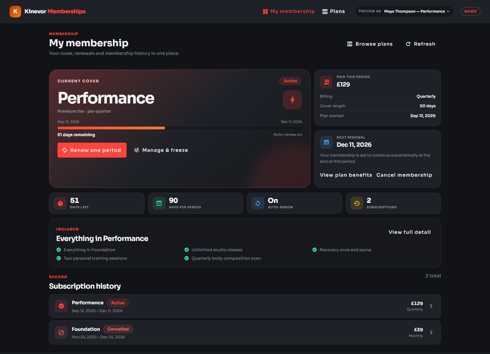
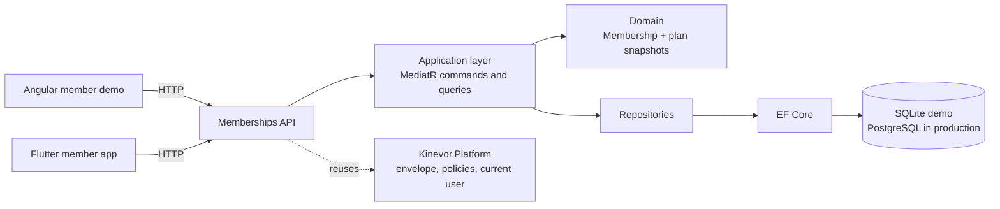
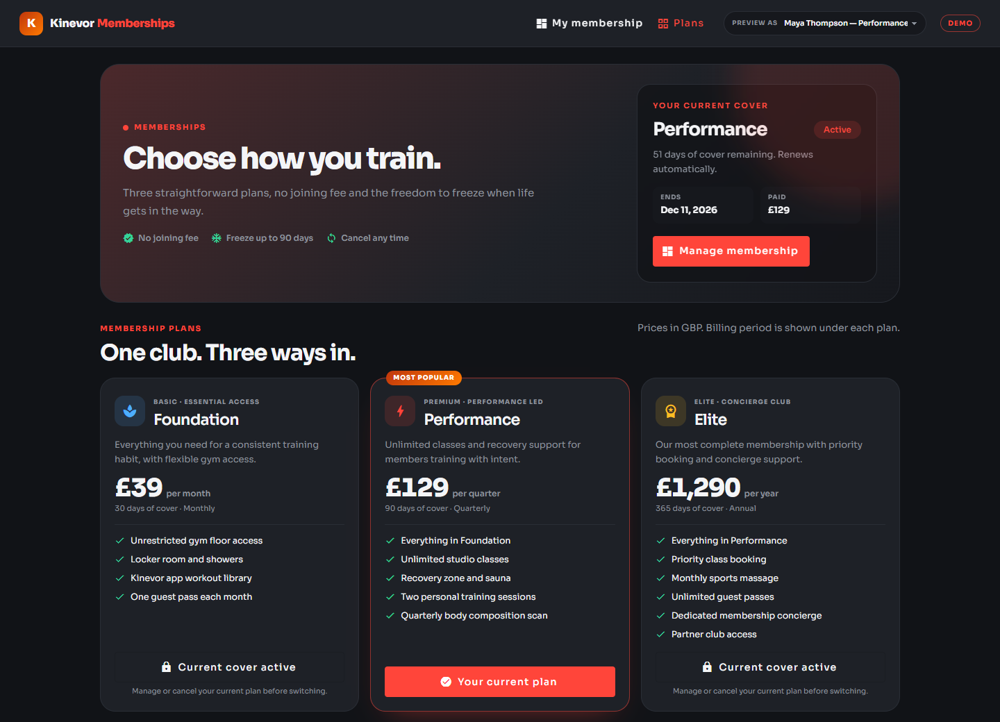
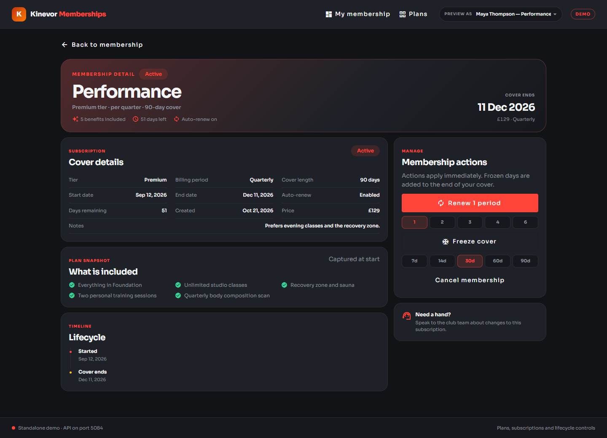
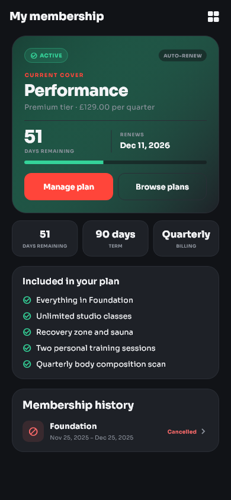
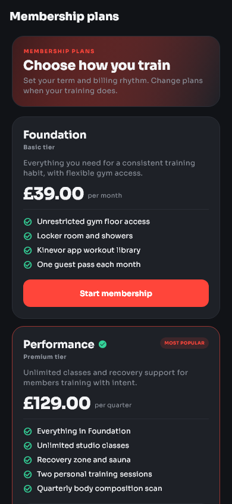
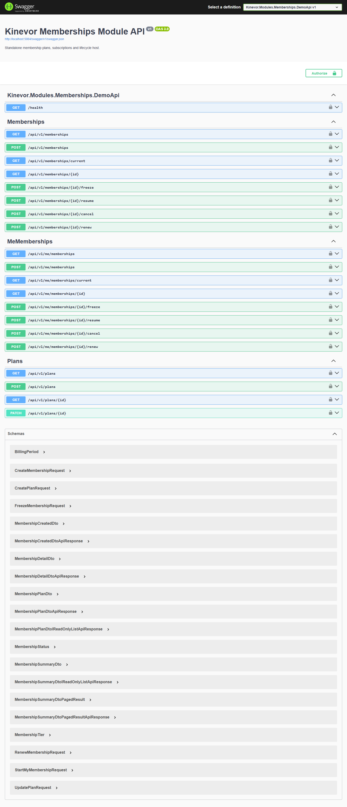

# Kinevor Memberships

Membership plans, recurring cover and the subscription lifecycle for the Kinevor
gym platform: a .NET 9 API, a standalone Angular 21 library and demo, and a
Flutter package with a runnable example. Every layer can be consumed
independently, and the demo runs locally without the original monorepo.

[](https://github.com/SoftwareDeveloper98/kinevor-memberships/actions/workflows/ci.yml)
[](https://github.com/SoftwareDeveloper98/kinevor-memberships/pkgs/nuget/Kinevor.Modules.Memberships)
[](https://github.com/SoftwareDeveloper98/kinevor-memberships/pkgs/npm/kinevor-memberships-web)
[](https://flutter.dev)
[](LICENSE)



## Why this module

Memberships is the commercial relationship between a member and the club: which
plan they bought, what it includes, when it renews and how it changes. This
repository packages that slice for staff administration and member self-service.

- Browse the plan catalogue and start a subscription with an overlap guard.
- Show current cover, renewal date, days remaining, billing and snapshotted
  benefits on member dashboards.
- Freeze cover for up to 90 days, then resume it and reclaim any unused frozen
  days at the end of cover.
- Renew by whole billing periods, or cancel permanently with clear consequences.
- Keep a subscription history after plans change or cover ends.
- Staff can list subscriptions, inspect a member's current cover and administer
  plans.
- Angular and Flutter clients share the same API contract.

## Architecture



The backend is organized into domain/application/API folders within a single project, with a separate EF Core persistence project. It depends
on the published `Kinevor.Platform.*` packages for the response envelope,
authorization policies and current-user abstractions. The Angular and Flutter
clients are thin presentation layers over typed gateways/repositories.

A subscription copies the plan name, tier, price, billing period and features at
start. Later plan edits never rewrite history. Effective status is calculated
from cover dates, while freeze and cancellation are explicit stored state.

## Features

- Three active demo plans plus an inactive corporate plan for staff-only reads.
- Plan snapshots, billing periods, duration and feature benefits.
- Current-cover dashboard with renewal date, progress, price, auto-renew and
  previous subscriptions.
- Plan comparison with current-plan detection and a start flow.
- Freeze with an inclusive end date and a 90-day cap; resuming returns any unused
  frozen days to the end of cover.
- Renew from the existing end date, or from today when cover has expired.
- Terminal cancellation with auto-renew disabled.
- Staff subscription search, current-cover lookup, start and lifecycle actions.
- Angular: standalone components, Material UI, typed gateway/facade, injectable
  provider, routes and Vitest tests.
- Flutter: injectable client/repository, dashboard, plan catalogue, detail
  actions, theme, strings, golden tests and a runnable member switcher example.
- SQLite demo with five seeded members, six subscriptions, four plans and Swagger.

## Endpoints

| Method | Route | Policy | Used by |
| --- | --- | --- | --- |
| `GET` | `/api/v1/plans?includeInactive=` | `MemberOrAbove` | Plan catalogue |
| `GET` | `/api/v1/plans/{id}` | `MemberOrAbove` | Plan detail |
| `POST` | `/api/v1/plans` | `StaffOrAdmin` | Plan creation |
| `PATCH` | `/api/v1/plans/{id}` | `StaffOrAdmin` | Plan update |
| `GET` | `/api/v1/memberships?memberId=&status=&page=&pageSize=` | `StaffOrAdmin` | Staff subscription list |
| `GET` | `/api/v1/memberships/current?memberId=` | `StaffOrAdmin` | Staff current-cover lookup |
| `GET` | `/api/v1/memberships/{id}` | `StaffOrAdmin` | Staff subscription detail |
| `POST` | `/api/v1/memberships` | `StaffOrAdmin` | Staff start |
| `POST` | `/api/v1/memberships/{id}/freeze` | `StaffOrAdmin` | Staff freeze |
| `POST` | `/api/v1/memberships/{id}/resume` | `StaffOrAdmin` | Staff resume |
| `POST` | `/api/v1/memberships/{id}/cancel` | `StaffOrAdmin` | Staff cancel |
| `POST` | `/api/v1/memberships/{id}/renew` | `StaffOrAdmin` | Staff renew |
| `GET` | `/api/v1/me/memberships` | `MemberOrAbove` | Member history |
| `GET` | `/api/v1/me/memberships/current` | `MemberOrAbove` | Current cover |
| `GET` | `/api/v1/me/memberships/{id}` | `MemberOrAbove` | Member detail |
| `POST` | `/api/v1/me/memberships` | `MemberOrAbove` | Start a plan |
| `POST` | `/api/v1/me/memberships/{id}/freeze` | `MemberOrAbove` | Freeze cover |
| `POST` | `/api/v1/me/memberships/{id}/resume` | `MemberOrAbove` | Resume cover |
| `POST` | `/api/v1/me/memberships/{id}/cancel` | `MemberOrAbove` | Cancel cover |
| `POST` | `/api/v1/me/memberships/{id}/renew` | `MemberOrAbove` | Renew cover |
| `GET` | `/health` | anonymous | Demo health check |
| `GET` | `/swagger` | development only | API explorer |

All responses use the platform `ApiResponse<T>` envelope. Starting a subscription
that overlaps the member's current cover is rejected with `409 Conflict`.
Self-service routes enforce ownership and return `404` for another member's
subscription.

## Screenshots

### Web

| Membership dashboard | Plan catalogue |
| --- | --- |
|  |  |

| Membership detail |
| --- |
|  |

### Flutter

| Membership dashboard | Plans |
| --- | --- |
|  |  |

### API



## Quick start

### Prerequisites

- .NET SDK 10 (the solution uses `.slnx`) and the ASP.NET Core 9 runtime.
- Node.js 22+ and npm 10+.
- Flutter 3.35+ (the repository is verified with Flutter 3.47.7).

### 1. Build the platform packages

The backend restores `Kinevor.Platform.*` from the sibling platform repository's
local package feed. Clone it next to this repository and pack it once:

```powershell
git clone https://github.com/SoftwareDeveloper98/kinevor-platform.git ..\kinevor-platform
dotnet pack ..\kinevor-platform\backend\Kinevor.Platform.slnx -c Release `
  -o ..\kinevor-platform\backend\artifacts\packages
```

If the platform packages are published to GitHub Packages, configure that source
instead and skip the local pack step.

### 2. Run the API

```powershell
dotnet restore backend\Kinevor.Modules.Memberships.slnx
dotnet run --project backend\samples\Kinevor.Modules.Memberships.DemoApi
```

The API listens on `http://localhost:5084`. Open
`http://localhost:5084/swagger` for the explorer. The demo creates a SQLite
database and seeds plans and subscriptions on first run.

| Plan | Tier | Billing | Price | State |
| --- | --- | --- | --- | --- |
| Foundation | Basic | Monthly | £39 | Active |
| Performance | Premium | Quarterly | £129 | Active |
| Elite | Elite | Annual | £1,290 | Active |
| Corporate | Standard | Annual | £990 | Inactive |

| Member | Member ID | Current cover |
| --- | --- | --- |
| Maya Thompson | `11111111-1111-1111-1111-111111111111` | Performance, active, previous Foundation history |
| Daniel Okafor | `22222222-2222-2222-2222-222222222222` | Foundation, active |
| Sofia Rossi | `33333333-3333-3333-3333-333333333333` | Elite, frozen for travel |
| Liam Chen | `44444444-4444-4444-4444-444444444444` | Expired Foundation, ready for a start flow |
| Amina Yusuf | `55555555-5555-5555-5555-555555555555` | Elite, annual |

The demo trusts development-only headers:

| Header | Purpose | Example |
| --- | --- | --- |
| `X-Demo-Role` | Selects the authenticated role | `Staff`, `Member`, `Admin` |
| `X-Demo-Email` | Sets the current user e-mail | `staff.demo@kinevor.local` |
| `X-Demo-User` | Sets the identity subject | any stable string |
| `X-Demo-Member` | Binds a member identity | Maya's member id |
| `X-Demo-Trainer` | Binds a trainer identity | trainer GUID |
| `X-Demo-Branch` | Selects the branch context | branch GUID |

These headers are a demo adapter only. Never enable them in production.

### 3. Run the web demo

For local development, build the platform web package once:

```powershell
cd ..\kinevor-platform\web
npm install
npm run build
cd ..\..\kinevor-memberships\web
npm run install:local
npm start
```

`npm run install:local` temporarily points the workspace at the local platform
build, installs dependencies, restores `package.json`, and removes the generated
lockfile. When the package is published to GitHub Packages, authenticate the
scope in `.npmrc` and use the normal path instead:

```powershell
cd web
npm install
npm start
```

The web demo runs at `http://localhost:4203`:

- `/memberships` - current cover, actions and history
- `/memberships/plans` - plan catalogue and start flow
- `/memberships/:id` - subscription detail and lifecycle actions

The demo interceptor sends the `Member` role and the selected member id. The
header's "Preview as" selector switches between Maya, Daniel, Sofia, Liam and
Amina. A real host supplies its own authentication and platform configuration.

### 4. Run the Flutter example

```powershell
cd mobile\packages\kinevor_memberships
flutter pub get
cd example
flutter run -d chrome
```

The example targets `http://localhost:5084/api/v1` by default. Override it for an
emulator or remote host:

```powershell
flutter run -d chrome `
  --dart-define=KINEVOR_API_BASE_URL=http://localhost:5084/api/v1
```

On an Android emulator use `http://10.0.2.2:5084/api/v1`. Use the person icon in
the app bar to switch demo members. The demo API allows the web origin
`http://localhost:4203`; add another origin before running Flutter web elsewhere.

### 5. Refresh screenshots

With both servers running:

```powershell
cd web
npm run capture:screenshots
```

The Playwright script writes the web and Swagger images to `docs/screenshots`.
Regenerate the Flutter goldens and copy them to the docs folder with:

```powershell
cd mobile\packages\kinevor_memberships
flutter test --update-goldens test\membership_golden_test.dart
Copy-Item test\goldens\membership_dashboard.png `
  ..\..\..\docs\screenshots\mobile-membership-dashboard.png
Copy-Item test\goldens\membership_plans.png `
  ..\..\..\docs\screenshots\mobile-plans.png
```

## Testing

| Area | Command |
| --- | --- |
| Backend | `dotnet test backend\Kinevor.Modules.Memberships.slnx -c Release` |
| Web unit tests | `cd web; npm test` |
| Web builds | `cd web; npm run build:all` |
| Flutter analysis | `cd mobile\packages\kinevor_memberships; flutter analyze` |
| Flutter tests | `cd mobile\packages\kinevor_memberships; flutter test` |

The backend suite covers plan validation, overlapping starts, freezing, resuming,
renewals, cancellation, ownership and the seeded demo host. The web suite covers
the HTTP gateway and facade with Vitest. The Flutter suite covers the HTTP client,
dashboard, catalogue and lifecycle screens, plus 390×844 golden images.

## Packages

| Ecosystem | Package | Contents |
| --- | --- | --- |
| NuGet | `Kinevor.Modules.Memberships` | Domain, application, API controllers and module registration |
| NuGet | `Kinevor.Modules.Memberships.EntityFrameworkCore` | `MembershipsDbContext`, mapping and repositories |
| npm | `@softwaredeveloper98/kinevor-memberships-web` | Angular components, gateway, facade, provider and routes |
| Flutter | `kinevor_memberships` | API client, repository, screens, theme and strings |

Install the Angular library after authenticating to GitHub Packages:

```powershell
npm install @softwaredeveloper98/kinevor-memberships-web
```

Consume the Flutter package from the repository tag:

```yaml
dependencies:
  kinevor_memberships:
    git:
      url: https://github.com/SoftwareDeveloper98/kinevor-memberships.git
      path: mobile/packages/kinevor_memberships
      ref: v0.1.0
```

Both clients use the same API contract. The Angular package expects
`@softwaredeveloper98/kinevor-platform-web` as a peer dependency.

CI restores the platform NuGet and npm packages from GitHub Packages. Publish
`kinevor-platform` `0.1.0` first, or the backend and web jobs will fail at
restore/install.

## Design decisions

- **Snapshot at purchase.** Subscriptions keep the plan name, tier, price,
  billing period and features they were sold with, so later catalogue edits do
  not rewrite history.
- **One current cover.** Starting another plan while cover overlaps is rejected;
  members must let cover end or cancel first.
- **Freeze is bounded and inclusive.** The `until` date is inclusive, freezes are
  limited to 90 days, and resuming restores unused frozen days.
- **Renewal is predictable.** A renewal adds whole billing periods to the existing
  end date, or starts from today when cover has expired.
- **Cancellation is terminal.** Cancelled cover cannot be renewed or resumed.
- **Ownership by default.** Self-service reads and actions are scoped to the
  authenticated member and hide other subscriptions as `404`.
- **Thin clients.** The Angular facade owns loading state; the Flutter package
  injects a repository so hosts can swap the HTTP implementation.
- **Demo auth is explicit.** Trust headers exist only in Development and are sent
  by the demo interceptor/client.
- **Visual contract in tests.** Playwright and Flutter goldens make layout,
  typography and icon regressions visible.

## Repository layout

```text
kinevor-memberships/
  backend/
    src/Kinevor.Modules.Memberships/          domain, application, API
    src/Kinevor.Modules.Memberships.EntityFrameworkCore/
    samples/Kinevor.Modules.Memberships.DemoApi/
    tests/Kinevor.Modules.Memberships.Tests/
  web/
    projects/kinevor-memberships/             Angular library
    projects/demo/                            demo host
    scripts/                                  local install + screenshots
  mobile/
    packages/kinevor_memberships/             Flutter package
    packages/kinevor_memberships/example/     runnable demo
  docs/
    screenshots/
  .github/workflows/
```

## Related modules

- [Kinevor Platform](https://github.com/SoftwareDeveloper98/kinevor-platform) -
  shared API, auth, i18n, notices and Angular primitives.
- [Kinevor Identity & Access](https://github.com/SoftwareDeveloper98/kinevor-identity-access)
- [Kinevor Members](https://github.com/SoftwareDeveloper98/kinevor-members)
- [Kinevor Trainers](https://github.com/SoftwareDeveloper98/kinevor-trainers)
- [Kinevor Classes & Bookings](https://github.com/SoftwareDeveloper98/kinevor-classes-bookings)
- [Kinevor Check-ins & Access](https://github.com/SoftwareDeveloper98/kinevor-checkins-access)
- [Kinevor Payments & Billing](https://github.com/SoftwareDeveloper98/kinevor-payments-billing)
- [Kinevor Notifications](https://github.com/SoftwareDeveloper98/kinevor-notifications)
- [Kinevor Public Site](https://github.com/SoftwareDeveloper98/kinevor-public-site)
- [Kinevor Staff Dashboard](https://github.com/SoftwareDeveloper98/kinevor-staff-dashboard)

## Release Checklist

- Confirm `kinevor-platform` `v0.1.0` is published.
- Add the `KINEVOR_PACKAGES_TOKEN` repository secret.
- Push tag `v0.1.0` after CI is green.

See [PUBLISHING.md](PUBLISHING.md) for the complete release and consumer setup.

## Security

The demo role headers are intentionally insecure and exist only for local
screenshots and tests. Production hosts must use the platform authentication
stack, enforce the published policies, and keep the demo adapter disabled. Do not
commit connection strings, tokens, PATs or `.env` files.

## License

MIT. See [LICENSE](LICENSE).
